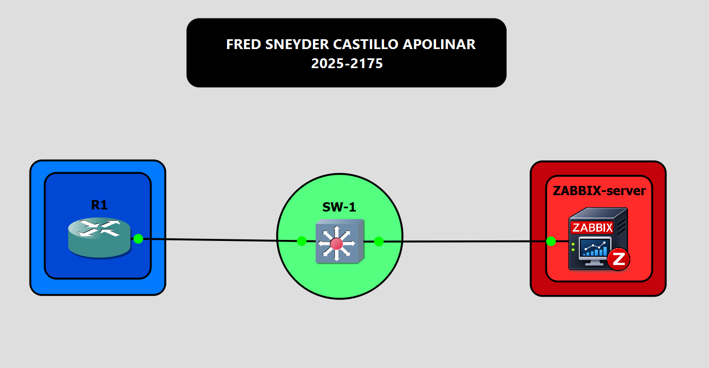
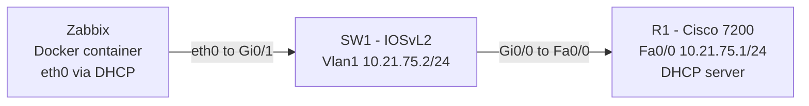
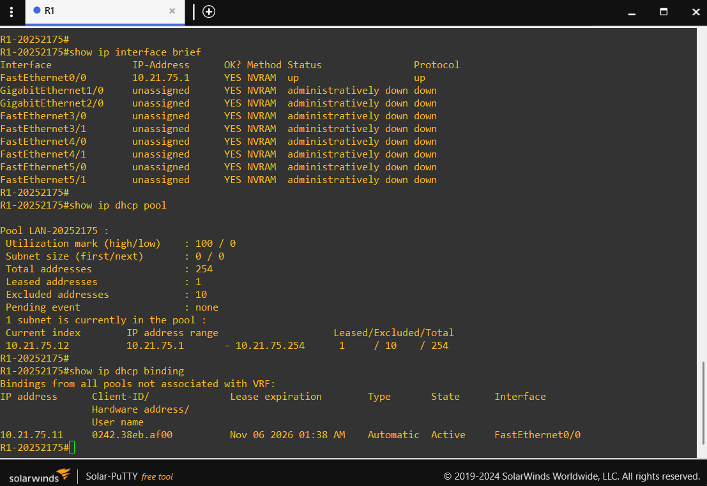
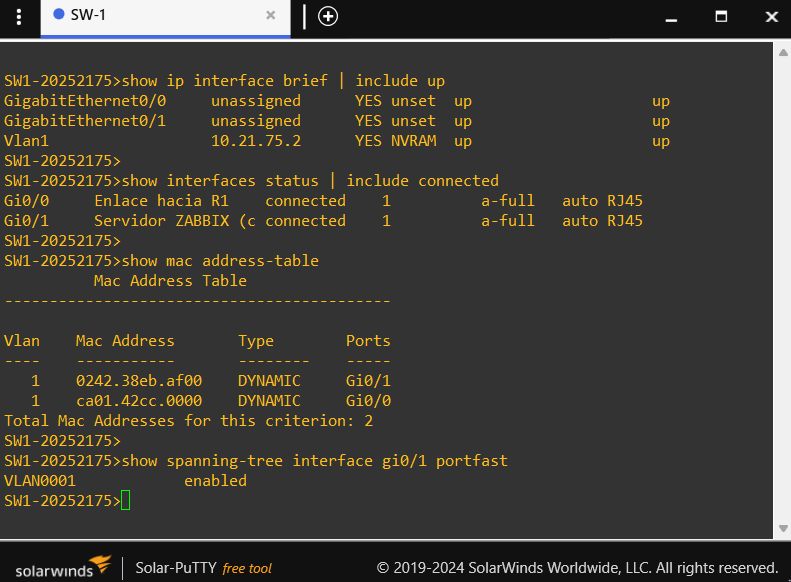
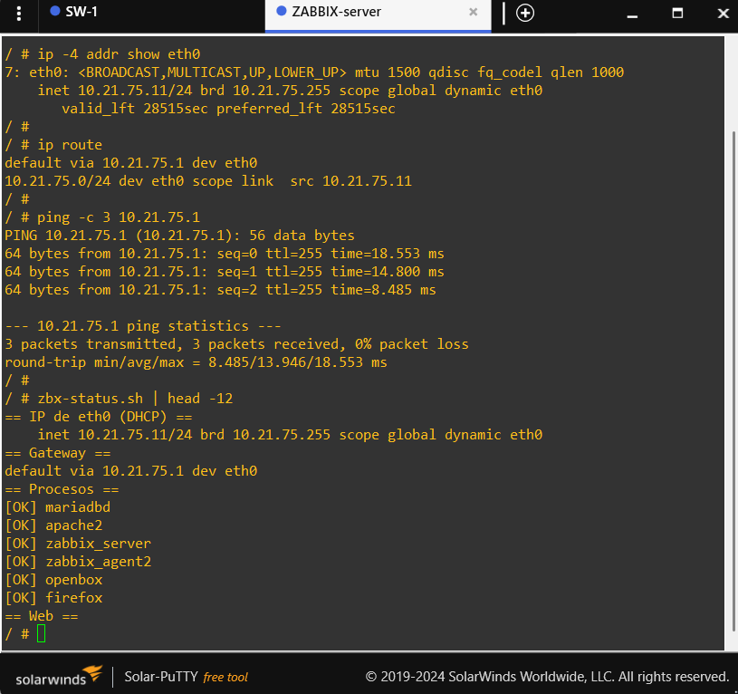
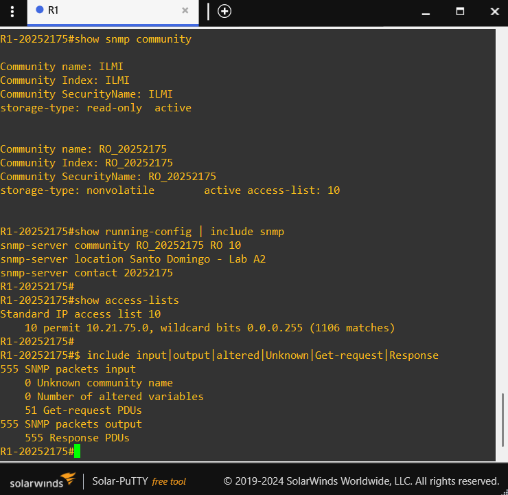
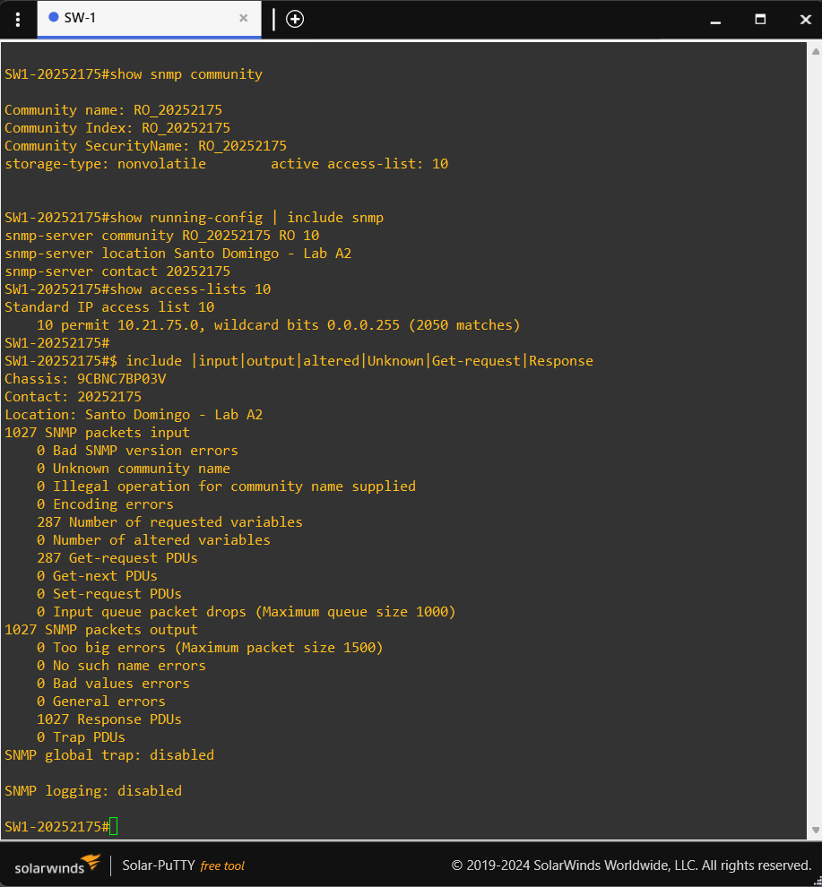

<div align="center">
    
# 📡 SNMP Monitoring with Zabbix and DHCP on GNS3 — Cisco 7200 + IOSvL2

[](docs/01-arquitectura.md) [](docs/02-router-r1.md) [](docs/03-switch-sw1.md) [](docs/04-contenedor-zabbix.md) [](docker/Zabbix)[](https://hub.docker.com/r/fredcastillo/zabbix-server) [](docs/09-seguridad.md)

</div>

> **Student:** Fred Sneyder Castillo Apolinar | **Student ID:** 2025-2175 | **Course:** Network Security | **Assignment:** A2 | **Environment:** GNS3

## 🎥 DEMONSTRATION VIDEO

<p align="center">
  <a href="https://youtu.be/K6qE3cIjSIw">
    
  </a>
</p>

* * *

## Lab purpose

This lab builds a managed and monitored local network. A **Cisco 7200 (R1)** provides addressing and **DHCP**, an **IOSvL2 switch (SW1)** interconnects the devices, and a **Zabbix 7.0 LTS** server, deployed as a Docker container inside GNS3, obtains its address through DHCP and monitors both network devices over **SNMP**.

From a **Network Security** perspective the lab demonstrates three controls:

1. **Centralized visibility:** status, uptime and interface traffic of R1 and SW1 are collected and graphed in Zabbix.
2. **Least privilege in SNMP:** the community is **read-only (RO)**, does not use the default `public` value and cannot change device configuration.
3. **Source restriction:** a standard ACL limits SNMP queries to the `10.21.75.0/24` network.

The Zabbix server is delivered as a reproducible Docker image with a graphical interface reachable from the GNS3 VNC console and a configuration that persists across project restarts.

* * *

## Assignment requirements covered

| Requirement                               | Implementation                                          |
|-------------------------------------------|---------------------------------------------------------|
| GitHub repository                         | This repository                                         |
| Demonstration video at the top            | Top section of this README                              |
| Documentation with images                 | `images/` and `docs/` folders                           |
| Documentation with diagrams               | Mermaid in README and `docs/01-arquitectura.md`         |
| Lab purpose                               | Section above                                           |
| Scripts used                              | `scripts/` and `docker/Zabbix/` folders                 |
| Running-configs                           | `configs/` folder                                       |
| IP addressing on router and switch        | R1 `10.21.75.1/24`, SW1 `10.21.75.2/24`                 |
| DHCP server for the LAN                   | R1, pool `LAN-20252175`                                 |
| Read-only SNMP community                  | `RO_20252175` on R1 and SW1, with ACL 10                |
| Zabbix server as DHCP client              | Docker container, `eth0` via DHCP                       |
| SNMP data of router and switch in Zabbix  | Hosts `R1-20252175` and `SW1-20252175`                  |

* * *

## Topology

[](images/01-topology-gns3.png)



## Addressing table

Lab network: **`10.21.75.0/24`** (derived from student ID 2025-2175).

| Device          | Interface            | Address          | Purpose                 |
|-----------------|----------------------|-----------------:|-------------------------|
| R1 (Cisco 7200) | `FastEthernet0/0`    | `10.21.75.1/24`  | Gateway and DHCP server |
| SW1 (IOSvL2)    | `Vlan1`              | `10.21.75.2/24`  | Switch management       |
| SW1 (IOSvL2)    | `ip default-gateway` | `10.21.75.1`     | Management gateway      |
| Zabbix          | `eth0`               | DHCP             | Monitoring server       |

| Range                  | Use                             |
|------------------------|---------------------------------|
| `10.21.75.1 – .10`     | Reserved (excluded from DHCP)   |
| `10.21.75.11 – .254`   | DHCP pool for clients           |

[](images/02-r1-ip-dhcp.png)

[](images/03-sw1-ip-mac.png)

## DHCP server

Runs on R1: pool `LAN-20252175`, network `10.21.75.0/24`, gateway `10.21.75.1`, DNS `8.8.8.8`, domain `lab.local`, 8-hour lease, exclusions `10.21.75.1 – 10.21.75.10`. The Zabbix container requests its address with `dhclient` at startup and retries until it gets one.

[](images/04-zabbix-dhcp-client.png)

## Read-only SNMP

```
access-list 10 permit 10.21.75.0 0.0.0.255
snmp-server community RO_20252175 RO 10
```

[](images/05-r1-snmp.png)

[](images/06-sw1-snmp.png)

## 📦 Zabbix Server (Docker Container)

This project uses a customized Docker image based on **Zabbix 7.0 LTS**, designed to run as an independent node inside GNS3.

The image integrates Zabbix Server, Zabbix Agent 2, MariaDB, Apache/PHP, Firefox ESR and Openbox, along with network and SNMP diagnostic tools.

**Published image:** [fredcastillo/zabbix-server](https://hub.docker.com/r/fredcastillo/zabbix-server)

**Tag used in this lab:** `7.0-v1`

### Included Components

| Component | Purpose |
|---|---|
| Zabbix Server 7.0 LTS | Centralized SNMP monitoring. |
| Zabbix Agent 2 | Container self-monitoring. |
| MariaDB | Configuration and monitoring data storage. |
| Apache + PHP | Zabbix web frontend. |
| Firefox ESR + Openbox | GNS3 VNC graphical environment. |
| DHCP Client | Dynamic IP configuration on `eth0`. |
| SNMP Utilities | Network monitoring and diagnostics. |

### Published Docker Image

| Tag | Description |
|---|---|
| `7.0-v1` | Image used and validated in the A2 lab. |
| `latest` | Alias pointing to the same V1 image. |

To download the exact image used in this project:

```bash
docker pull fredcastillo/zabbix-server:7.0-v1
```

### GNS3 Persistence Configuration

| Setting | Value |
|---|---|
| Console type | `vnc` |
| Resolution | `1280x800` |
| Network configuration | DHCP |
| Persistent directory | `/var/lib/mysql` |

MariaDB persistence preserves hosts, templates, credentials and monitoring data across GNS3 project restarts.

**Source code:** [`docker/Zabbix/`](docker/Zabbix)

**Technical documentation:** [`04-contenedor-zabbix.md`](docs/04-contenedor-zabbix.md) · [`07-persistencia.md`](docs/07-persistencia.md)

## Running-configs and 📜 scripts

- [R1 running-config](configs/R1/running-config.txt) · [SW1 running-config](configs/SW1/running-config.txt)
- [`scripts/`](scripts) · [`docker/Zabbix/`](docker/Zabbix) · [Script reference](docs/08-referencia-scripts.md)

The technical documentation in `docs/` is written in Spanish. Spanish version: [README.md](README.md)

## 👨‍💻 Author

**Fred Castillo**  
*Information Security Technologist*  
*Red Team | Offensive Security*

[](https://www.linkedin.com/in/fredcastillo11/)
[](https://github.com/fredcastillo)
[](https://hub.docker.com/u/fredcastillo)
