# 📡 Monitoreo SNMP con Zabbix y DHCP en GNS3 — Cisco 7200 + IOSvL2

[](docs/01-arquitectura.md) [](docs/02-router-r1.md) [](docs/03-switch-sw1.md) [](docs/04-contenedor-zabbix.md) [](https://hub.docker.com/r/fredcastillo/zabbix-server) [](docs/09-seguridad.md)

> **Estudiante:** Fred Sneyder Castillo Apolinar | **Matrícula:** 2025-2175 | **Asignatura:** Seguridad de Redes | **Práctica:** A2 | **Entorno:** GNS3

## 🎥 VIDEO DEMOSTRATIVO

[](https://www.youtube.com/watch?v=VIDEO_ID)

* * *

## Propósito del laboratorio

Este laboratorio implementa una red local administrada y monitoreada. Un **Cisco 7200 (R1)** proporciona el direccionamiento y el servicio **DHCP**, un **switch IOSvL2 (SW1)** interconecta los equipos, y un servidor **Zabbix 7.0 LTS** desplegado como contenedor Docker dentro de GNS3 obtiene su dirección por DHCP y monitorea ambos equipos de red mediante **SNMP**.

Desde el punto de vista de **Seguridad de Redes**, el laboratorio demuestra tres controles:

1. **Visibilidad centralizada:** el estado, el uptime y el tráfico de las interfaces de R1 y SW1 se recolectan y se grafican en Zabbix.
2. **Mínimo privilegio en SNMP:** la comunidad es de **solo lectura (RO)**, no usa el valor por defecto `public` y no permite modificar la configuración de los equipos.
3. **Restricción por origen:** una ACL estándar limita las consultas SNMP a la red `10.21.75.0/24`.

Además, el servidor Zabbix se entrega como una imagen Docker reproducible, con interfaz gráfica accesible desde la consola VNC de GNS3 y con la configuración persistente entre reinicios del proyecto.

El laboratorio debe demostrar:

1. R1 entrega direcciones IP por DHCP y el servidor Zabbix las obtiene como cliente DHCP.
2. R1 y SW1 responden consultas SNMP de solo lectura desde Zabbix.
3. Los datos SNMP de ambos equipos son visibles en Zabbix y se actualizan de forma continua.

* * *

## Requisitos de la asignación cubiertos

| Requisito                                    | Implementación                                               |
|----------------------------------------------|--------------------------------------------------------------|
| Repositorio de GitHub                        | Este repositorio                                             |
| Video demostrativo al inicio del repositorio | Sección superior de este README                              |
| Documentación con imágenes                   | Carpeta `images/` y carpeta `docs/`                          |
| Documentación con diagramas                  | Mermaid en README y `docs/01-arquitectura.md`                |
| Propósito del laboratorio                    | Sección anterior                                             |
| Scripts utilizados                           | Carpetas `scripts/` y `docker/Zabbix/`                       |
| Running-configs                              | Carpeta `configs/`                                           |
| Direccionamiento IP en router y switch       | R1 `10.21.75.1/24`, SW1 `10.21.75.2/24`                      |
| Servidor DHCP para la LAN                    | R1, pool `LAN-20252175`                                      |
| Comunidad SNMP de solo lectura               | `RO_20252175` en R1 y SW1, con ACL 10                        |
| Servidor Zabbix como cliente DHCP            | Contenedor Docker, `eth0` por DHCP                           |
| Datos SNMP del router y del switch en Zabbix | Hosts `R1-20252175` y `SW1-20252175`                         |

* * *

## Topología

### Captura real de GNS3

[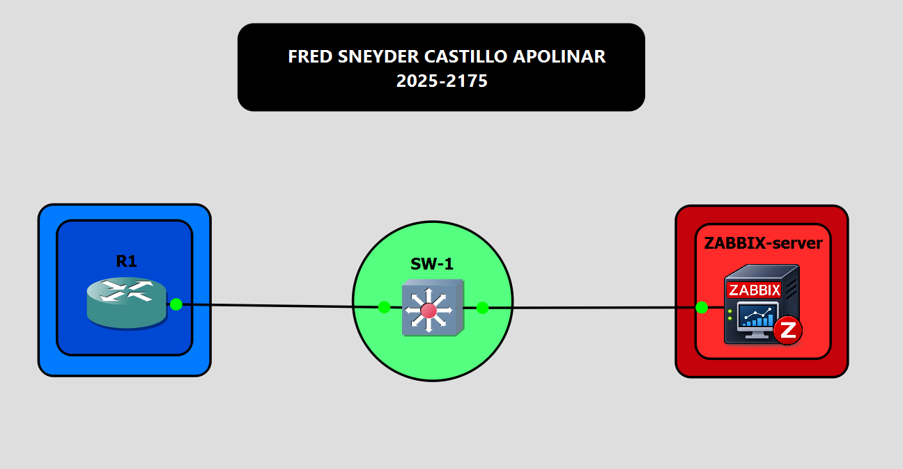](images/01-topology-gns3.png)

### Diagrama lógico

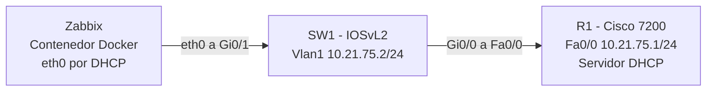

### Flujo de datos esperado

```
Zabbix (cliente DHCP)
  │
  │ DHCPDISCOVER / REQUEST
  ▼
SW1 (10.21.75.2) ───────────► R1 (10.21.75.1)  entrega IP 10.21.75.11 - 10.21.75.254
  ▲                              ▲
  │ SNMP GET (UDP 161)           │ SNMP GET (UDP 161)
  └──────────── Zabbix ──────────┘
        comunidad RO_20252175 (solo lectura, ACL 10)
```

* * *

## 🌐 Tabla de direccionamiento

Red del laboratorio: **`10.21.75.0/24`** (basada en la matrícula 2025-2175).

| Elemento        | Interfaz                | Dirección          | Uso                              |
|-----------------|-------------------------|-------------------:|----------------------------------|
| R1 (Cisco 7200) | `FastEthernet0/0`       | `10.21.75.1/24`    | Gateway y servidor DHCP          |
| SW1 (IOSvL2)    | `Vlan1`                 | `10.21.75.2/24`    | Gestión del switch               |
| SW1 (IOSvL2)    | `ip default-gateway`    | `10.21.75.1`       | Salida de la gestión             |
| Zabbix          | `eth0`                  | DHCP               | Servidor de monitoreo            |
| Red LAN         | —                       | `10.21.75.0/24`    | VLAN 1 (predeterminada)          |

| Rango                     | Uso                         |
|---------------------------|-----------------------------|
| `10.21.75.1 – .10`        | Reservado (excluido de DHCP)|
| `10.21.75.11 – .254`      | Pool DHCP para clientes     |

[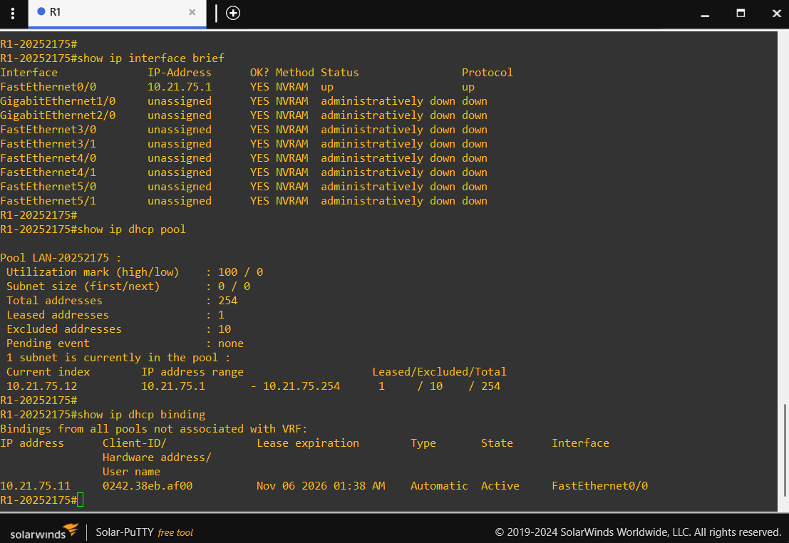](images/02-r1-ip-dhcp.png)

[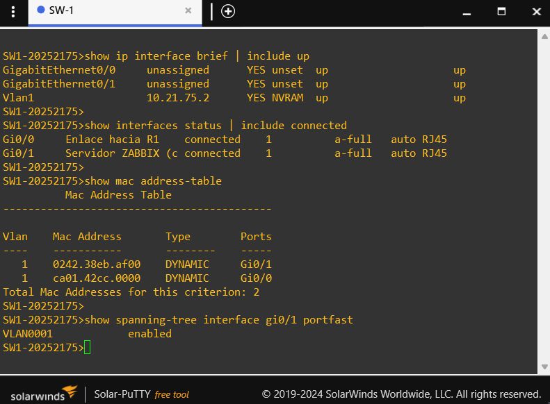](images/03-sw1-ip-mac.png)

* * *

## 🖧 Servidor DHCP

El DHCP se ejecuta en R1:

- Pool: `LAN-20252175`
- Red: `10.21.75.0/24`
- Gateway: `10.21.75.1`
- DNS: `8.8.8.8`
- Dominio: `lab.local`
- Lease: 8 horas
- Exclusiones: `10.21.75.1 – 10.21.75.10`

El contenedor Zabbix pide su dirección a R1 mediante `dhclient` al arrancar y reintenta hasta obtenerla.

[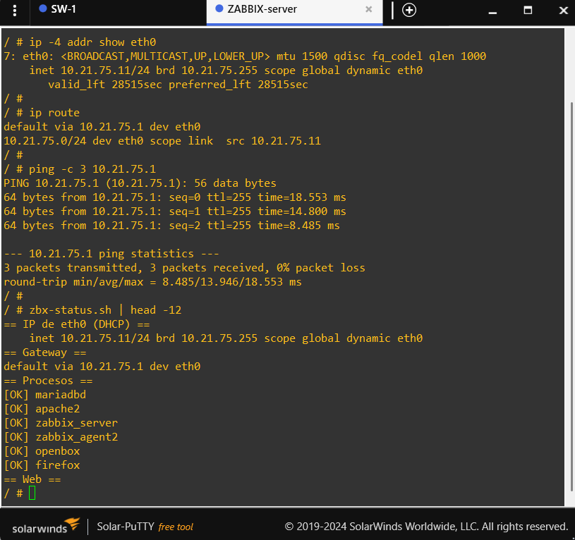](images/04-zabbix-dhcp-client.png)

* * *

## 🔐 SNMP de solo lectura

| Parámetro          | Valor                                  |
|--------------------|----------------------------------------|
| Versión            | SNMPv2c                                |
| Comunidad          | `RO_20252175`                          |
| Permiso            | `RO` (solo lectura)                    |
| ACL asociada       | `access-list 10 permit 10.21.75.0 0.0.0.255` |
| Puerto             | UDP 161                                |
| Equipos            | R1 y SW1                               |

```
access-list 10 permit 10.21.75.0 0.0.0.255
snmp-server community RO_20252175 RO 10
```

[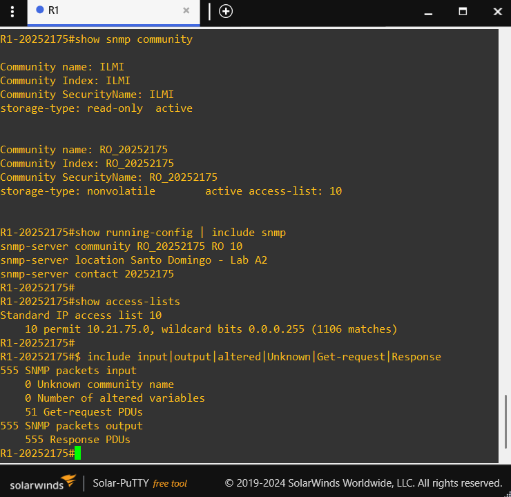](images/05-r1-snmp.png)

[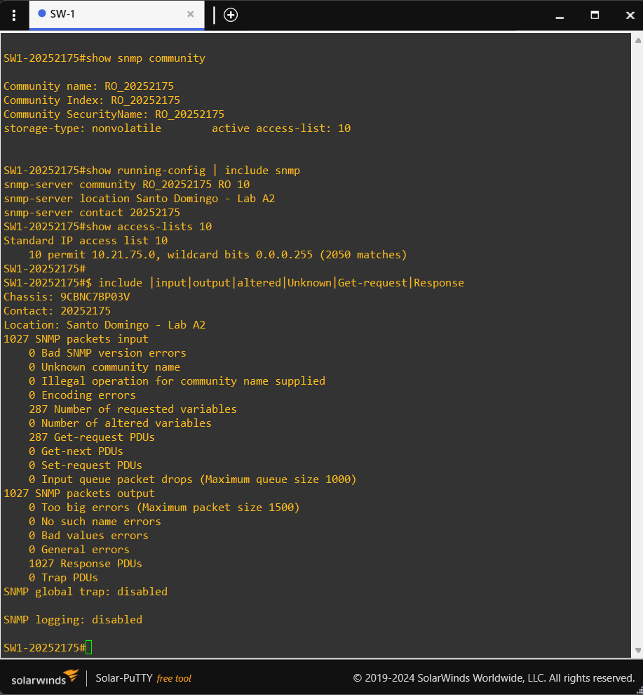](images/06-sw1-snmp.png)

* * *

## 📦 Servidor Zabbix (contenedor Docker)

Imagen `zabbix:7.0`, construida desde el `Dockerfile` de [`docker/Zabbix`](docker/Zabbix). Contiene en un solo contenedor:

| Componente              | Función                                              |
|-------------------------|------------------------------------------------------|
| Zabbix server 7.0 LTS   | Motor de recolección SNMP                            |
| Zabbix agent 2          | Monitoreo del propio servidor                        |
| MariaDB                 | Base de datos de Zabbix (precargada en la imagen)    |
| Apache + PHP            | Frontend web                                         |
| Firefox ESR + openbox   | Interfaz gráfica sobre la consola VNC de GNS3        |
| supervisord             | Gestor de procesos del contenedor                    |
| dhclient                | Cliente DHCP en `eth0`                               |

Plantilla en GNS3:

| Campo                             | Valor              |
|-----------------------------------|--------------------|
| Name                              | `Zabbix`           |
| Adapters                          | 1                  |
| Console type                      | `vnc`              |
| Console resolution                | `1280x800`         |
| Additional persistent directories | `/var/lib/mysql`   |

Documentación completa: [`docs/04-contenedor-zabbix.md`](docs/04-contenedor-zabbix.md) y [`docs/07-persistencia.md`](docs/07-persistencia.md).

* * *

## Validación funcional

### 1. Hosts SNMP en Zabbix

Los hosts `R1-20252175` y `SW1-20252175` se crearon con interfaz SNMPv2, la plantilla **Cisco IOS by SNMP** y la macro `{$SNMP_COMMUNITY}`. En *Data collection → Hosts*, el indicador **SNMP** aparece en verde en ambos.

[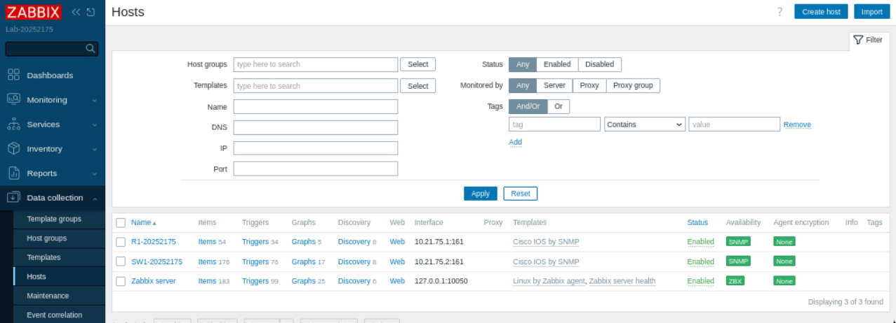](images/07-zabbix-hosts-snmp.png)

### 2. Datos recolectados de R1

[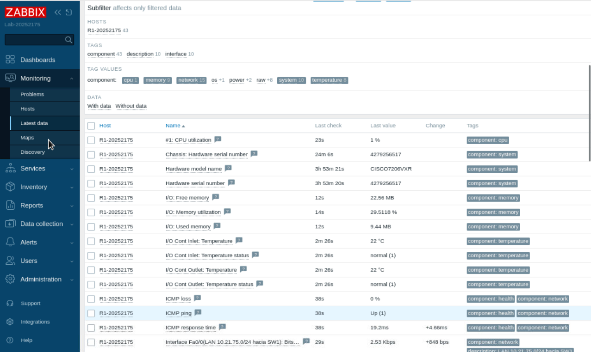](images/08-zabbix-latest-data-r1.png)

### 3. Datos recolectados de SW1

[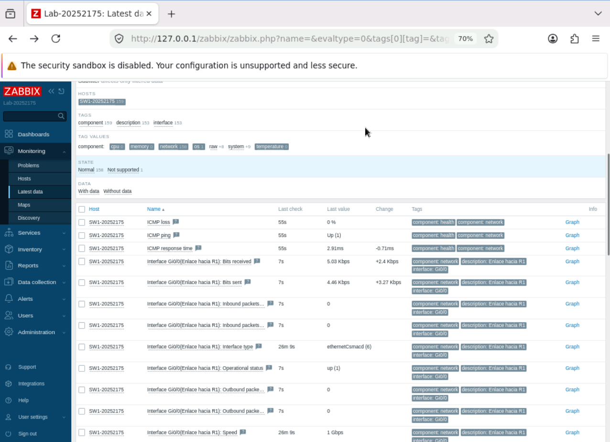](images/09-zabbix-latest-data-sw1.png)

### 4. SNMP es de solo lectura

Desde el contenedor Zabbix se comprueba que la lectura funciona, que la escritura es rechazada y que una comunidad incorrecta no obtiene respuesta:

```
snmpget -v2c -c RO_20252175 10.21.75.1 1.3.6.1.2.1.1.1.0
snmpset -v2c -c RO_20252175 10.21.75.1 1.3.6.1.2.1.1.5.0 s PRUEBA
snmpget -v2c -c public 10.21.75.1 1.3.6.1.2.1.1.1.0
```

[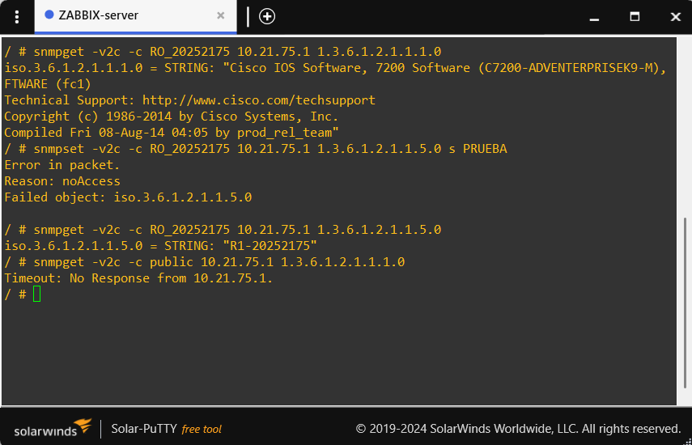](images/10-snmp-read-only-test.png)

### 5. Persistencia de la configuración

Tras detener los nodos, cerrar y reabrir el proyecto, Zabbix conserva la clave de Admin y los hosts, y el SNMP vuelve a estar disponible.

[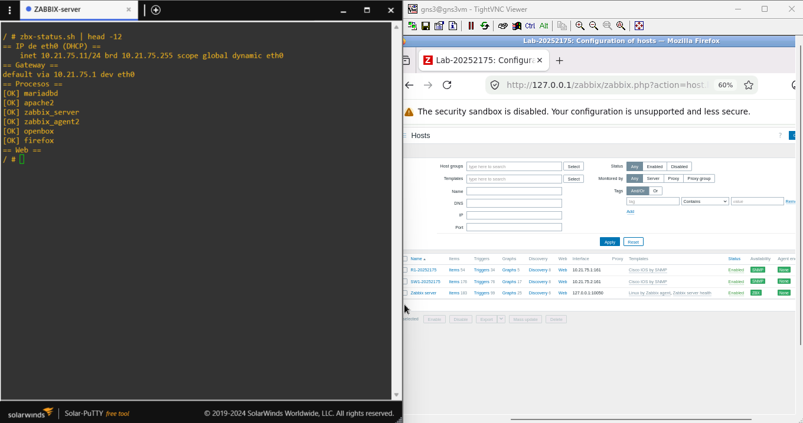](images/11-persistence-test.png)

Resultados detallados de cada prueba: [`docs/06-verificacion.md`](docs/06-verificacion.md).

* * *

## Evidencias mínimas

| Archivo                            | Evidencia                                        |
|------------------------------------|--------------------------------------------------|
| `01-topology-gns3.png`             | Topología GNS3 con cables e interfaces           |
| `02-r1-ip-dhcp.png`                | IP, pool y binding DHCP en R1                    |
| `03-sw1-ip-mac.png`                | IP de gestión, puertos y tabla MAC en SW1        |
| `04-zabbix-dhcp-client.png`        | IP de `eth0` obtenida por DHCP en Zabbix         |
| `05-r1-snmp.png`                   | Comunidad RO, ACL y contadores SNMP en R1        |
| `06-sw1-snmp.png`                  | Comunidad RO, ACL y contadores SNMP en SW1       |
| `07-zabbix-hosts-snmp.png`         | Hosts con SNMP en verde                          |
| `08-zabbix-latest-data-r1.png`     | Datos SNMP de R1 en Zabbix                       |
| `09-zabbix-latest-data-sw1.png`    | Datos SNMP de SW1 en Zabbix                      |
| `10-snmp-read-only-test.png`       | Lectura permitida, escritura y comunidad inválida rechazadas |
| `11-persistence-test.png`          | Configuración conservada tras reiniciar          |

* * *

## Running-Configs

- [R1 — running-config](configs/R1/running-config.txt)
- [SW1 — running-config](configs/SW1/running-config.txt)

* * *

## 📜 Scripts y comandos utilizados

| Archivo                                                      | Descripción                                      |
|--------------------------------------------------------------|--------------------------------------------------|
| [`scripts/r1-config.txt`](scripts/r1-config.txt)             | Configuración aplicada en R1                     |
| [`scripts/sw1-config.txt`](scripts/sw1-config.txt)           | Configuración aplicada en SW1                    |
| [`scripts/verification-commands.md`](scripts/verification-commands.md) | Comandos de verificación                |
| [`scripts/build-image.sh`](scripts/build-image.sh)           | Construcción de la imagen `zabbix:7.0`           |
| [`scripts/test-container.sh`](scripts/test-container.sh)     | Prueba del contenedor fuera de GNS3              |
| [`scripts/publish-image.sh`](scripts/publish-image.sh)       | Publicación de la imagen en Docker Hub           |
| [`docker/Zabbix/`](docker/Zabbix)                            | Dockerfile y scripts internos del contenedor     |

Referencia detallada de cada script: [`docs/08-referencia-scripts.md`](docs/08-referencia-scripts.md).

* * *

## Documentación técnica

| Documento                                                    | Contenido                                       |
|--------------------------------------------------------------|-------------------------------------------------|
| [`docs/01-arquitectura.md`](docs/01-arquitectura.md)         | Diagramas, direccionamiento y flujos            |
| [`docs/02-router-r1.md`](docs/02-router-r1.md)               | Configuración de R1 explicada                   |
| [`docs/03-switch-sw1.md`](docs/03-switch-sw1.md)             | Configuración de SW1 explicada                  |
| [`docs/04-contenedor-zabbix.md`](docs/04-contenedor-zabbix.md) | Diseño, construcción y uso de la imagen       |
| [`docs/05-zabbix-snmp.md`](docs/05-zabbix-snmp.md)           | Alta de hosts y plantillas SNMP en Zabbix       |
| [`docs/06-verificacion.md`](docs/06-verificacion.md)         | Pruebas y resultados                            |
| [`docs/07-persistencia.md`](docs/07-persistencia.md)         | Persistencia de la configuración del contenedor |
| [`docs/08-referencia-scripts.md`](docs/08-referencia-scripts.md) | Referencia de scripts                       |
| [`docs/09-seguridad.md`](docs/09-seguridad.md)               | Controles de seguridad y limitaciones           |

Versión en inglés: [README-EN.md](README-EN.md)

* * *

### Imagen Docker publicada

La imagen personalizada está disponible públicamente en Docker Hub.

**Docker Hub:** [fredcastillo/zabbix-server](https://hub.docker.com/r/fredcastillo/zabbix-server)

Para descargar la versión utilizada en este laboratorio:

\```bash
docker pull fredcastillo/zabbix-server:7.0-v1
\```

## 👨‍💻 Autor

**Fred Castillo**  
*Tecnólogo en Seguridad Informática*  
*Red Team | Seguridad Ofensiva*

[](https://www.linkedin.com/in/fredcastillo11/) [](https://github.com/fredcastillo)
[](https://hub.docker.com/u/fredcastillo)
