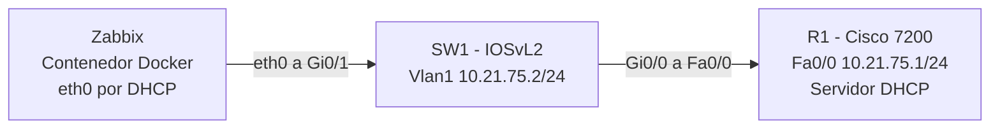
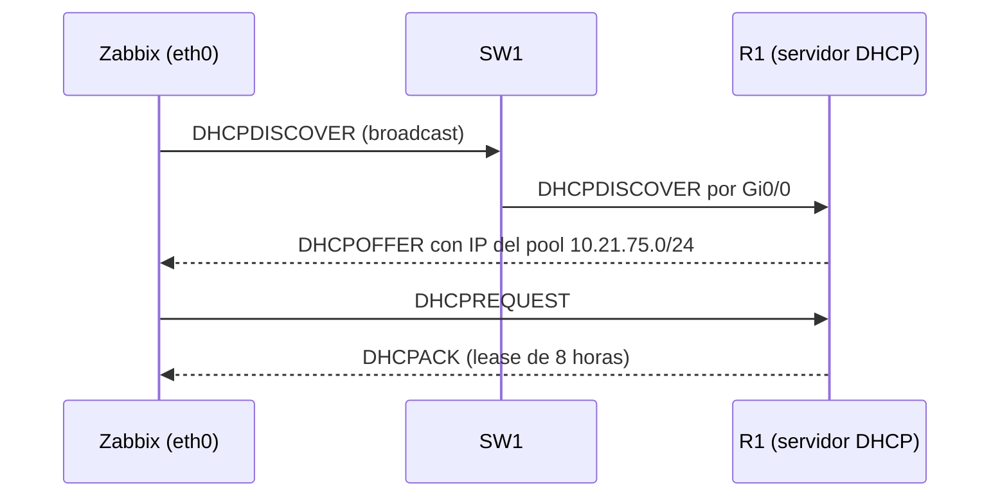
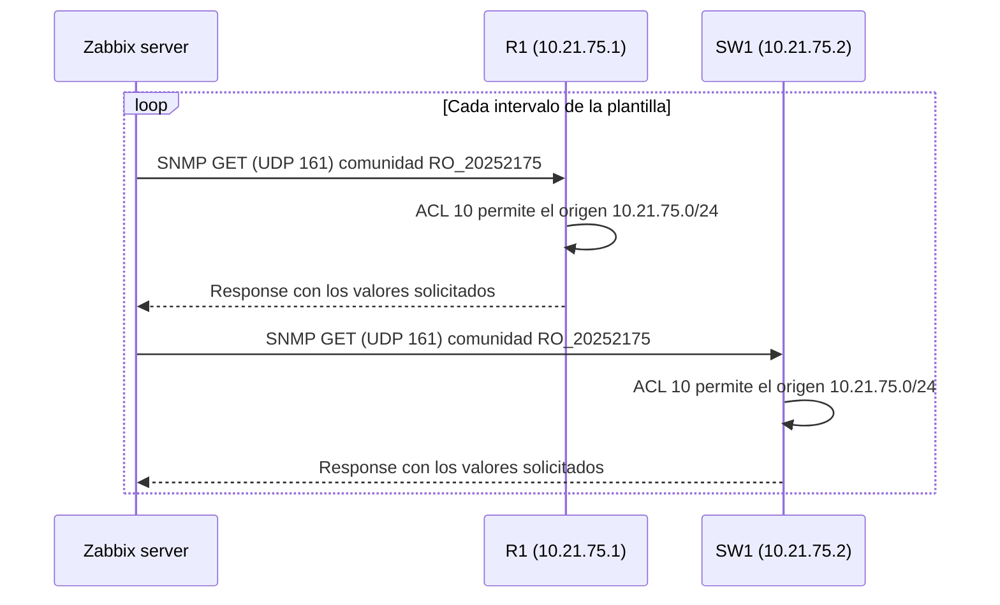
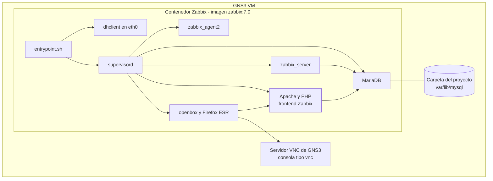

# 01 — Arquitectura del laboratorio

## 1. Visión general

La infraestructura está formada por tres nodos conectados en una única red de capa 2/3, `10.21.75.0/24`:

| Nodo   | Tipo                           | Rol                                                    |
|--------|--------------------------------|--------------------------------------------------------|
| R1     | Router Cisco 7200 (IOS 15.2)   | Gateway, servidor DHCP y agente SNMP                   |
| SW1    | Switch IOSvL2 (IOS 15.2)       | Conmutación de capa 2, gestión en VLAN 1 y agente SNMP |
| Zabbix | Contenedor Docker (`zabbix:7.0`) | Cliente DHCP y servidor de monitoreo SNMP            |

## 2. Diagrama de topología

### Cableado

| Origen            | Destino             | Descripción                    |
|-------------------|---------------------|--------------------------------|
| R1 `Fa0/0`        | SW1 `Gi0/0`         | Enlace de la LAN hacia el router |
| SW1 `Gi0/1`       | Zabbix `eth0`       | Puerto de acceso del servidor  |

## 3. Plan de direccionamiento IP

El segmento se basa en la matrícula 2025-2175: **`10.21.75.0/24`**.

| Dirección / rango      | Asignación                         | Método   |
|------------------------|------------------------------------|----------|
| `10.21.75.0`           | Dirección de red                   | —        |
| `10.21.75.1`           | R1 `FastEthernet0/0` (gateway)     | Estático |
| `10.21.75.2`           | SW1 `Vlan1` (gestión)              | Estático |
| `10.21.75.3 – .10`     | Reservado, excluido del pool       | —        |
| `10.21.75.11 – .254`   | Pool DHCP (clientes, entre ellos Zabbix) | DHCP |
| `10.21.75.255`         | Broadcast                          | —        |

Máscara `255.255.255.0`. El rango entregable por DHCP es de 244 direcciones. Las direcciones de infraestructura (`.1` y `.2`) son estáticas para que el router y el switch se puedan monitorear siempre en la misma IP, mientras que el servidor Zabbix, que no necesita ser consultado por otros equipos, usa DHCP.

## 4. Flujo DHCP

El puerto `Gi0/1` de SW1 tiene `spanning-tree portfast`, de modo que pasa a reenviar tráfico de inmediato y el servidor no espera la convergencia de STP para recibir su dirección. El contenedor reintenta la solicitud cada pocos segundos hasta obtener IP, por lo que no importa si arranca antes de que R1 esté listo.

## 5. Flujo SNMP

Zabbix actúa siempre como administrador (*manager*) que consulta. R1 y SW1 solo responden. No hay `snmp-server enable traps` ni comunidades de escritura.

## 6. Arquitectura del contenedor Zabbix

| Elemento        | Detalle                                                                          |
|-----------------|----------------------------------------------------------------------------------|
| Base            | Debian 12                                                                        |
| Zabbix          | 7.0 LTS desde el repositorio oficial de Zabbix                                   |
| Procesos        | `supervisord` arranca MariaDB, Apache, `zabbix_server`, `zabbix_agent2` y la interfaz gráfica |
| Interfaz gráfica| openbox y Firefox ESR sobre el display que GNS3 crea para la consola `vnc`       |
| Base de datos   | Creada e importada durante `docker build`, por lo que el primer arranque es rápido |
| Persistencia    | `/var/lib/mysql` como directorio persistente de GNS3                             |

Detalle de construcción: [`04-contenedor-zabbix.md`](04-contenedor-zabbix.md).

## 7. Componentes y versiones

| Componente             | Versión / imagen                           |
|------------------------|--------------------------------------------|
| Simulador              | GNS3 con GNS3 VM                           |
| Router                 | Cisco 7200, IOS 15.2                       |
| Switch                 | IOSvL2, IOS 15.2                           |
| Contenedor             | Debian 12, Zabbix 7.0 LTS                  |
| Navegador del contenedor | Firefox ESR                              |
| Plantilla SNMP         | Cisco IOS by SNMP (incluida en Zabbix)     |
