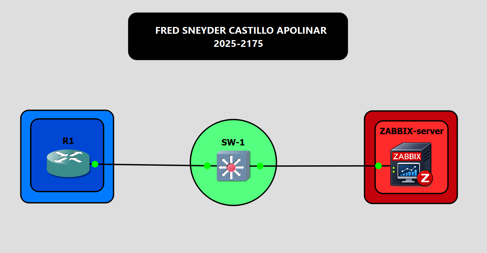
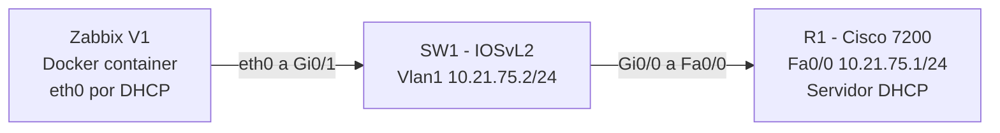
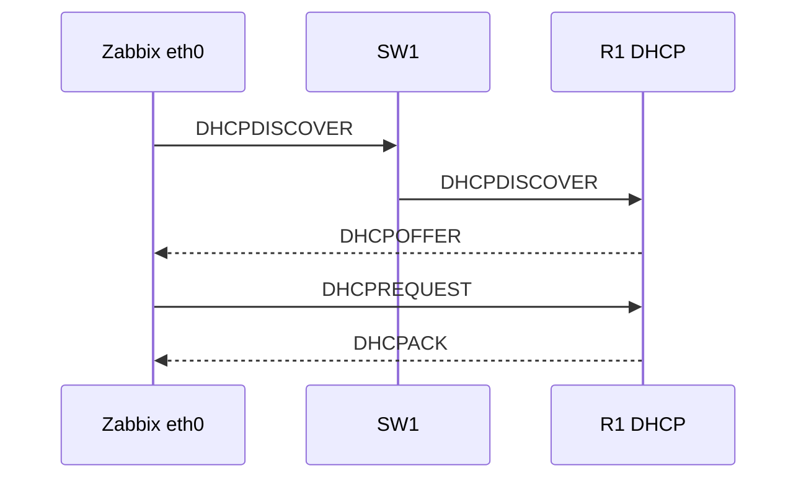
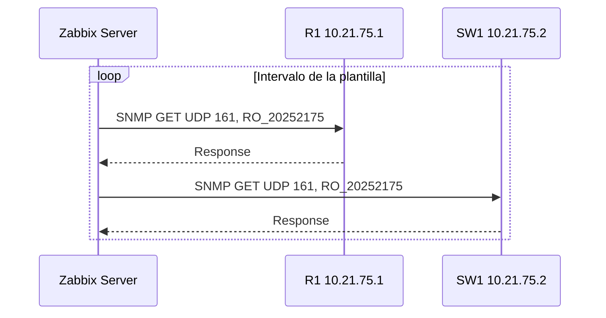
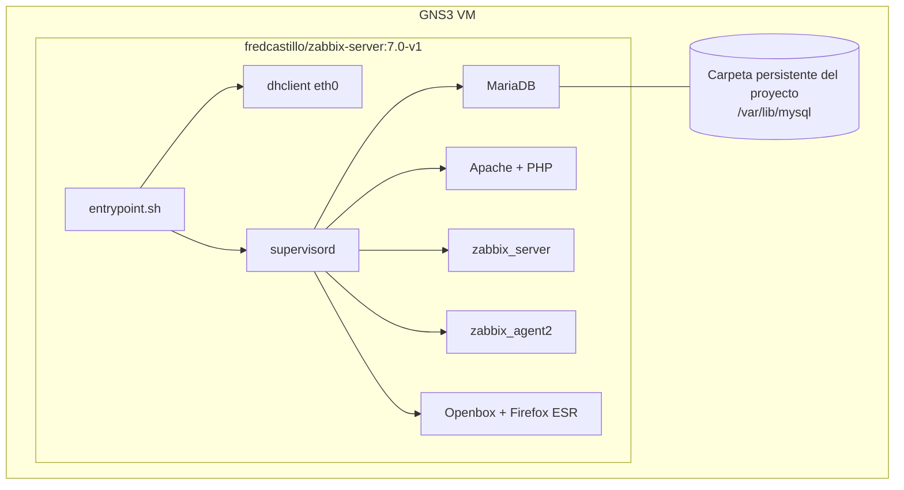

# 01 — Arquitectura del laboratorio

## 1. Visión general

La infraestructura está formada por tres nodos conectados en una única red de capa 2/3, `10.21.75.0/24`:

| Nodo | Tipo | Rol |
|---|---|---|
| R1 | Router Cisco 7200 (IOS 15.2) | Gateway, servidor DHCP y agente SNMP |
| SW1 | Switch IOSvL2 (IOS 15.2) | Conmutación de capa 2, gestión en VLAN 1 y agente SNMP |
| Zabbix | Contenedor Docker `fredcastillo/zabbix-server:7.0-v1` | Cliente DHCP y servidor de monitorización SNMP |

## 2. Diagrama de topología

### Cableado

| Origen | Destino | Descripción |
|---|---|---|
| R1 `Fa0/0` | SW1 `Gi0/0` | Enlace LAN hacia el router |
| SW1 `Gi0/1` | Zabbix `eth0` | Puerto de acceso del servidor |

## 3. Plan de direccionamiento

El segmento se basa en la matrícula 2025-2175: `10.21.75.0/24`.

| Dirección / rango | Asignación | Método |
|---|---|---|
| `10.21.75.0` | Dirección de red | — |
| `10.21.75.1` | R1 `FastEthernet0/0` (gateway) | Estático |
| `10.21.75.2` | SW1 `Vlan1` (gestión) | Estático |
| `10.21.75.3 – .10` | Reservado/excluido | — |
| `10.21.75.11 – .254` | Pool DHCP, incluido Zabbix | DHCP |
| `10.21.75.255` | Broadcast | — |

Máscara `255.255.255.0`. R1 entrega DHCP; Zabbix obtiene dinámicamente su dirección. En la prueba documentada recibió `10.21.75.11/24` con gateway `10.21.75.1`.

## 4. Flujo DHCP

## 5. Flujo SNMP

R1 y SW1 aplican la comunidad SNMPv2c de solo lectura y ACL 10 para limitar los orígenes a `10.21.75.0/24`.

## 6. Arquitectura del contenedor V1

| Elemento | Detalle |
|---|---|
| Base | Debian 12 |
| Zabbix | 7.0 LTS desde el repositorio oficial |
| Procesos | Supervisor mantiene MariaDB, Apache, Zabbix Server, Agent 2 y GUI |
| Interfaz gráfica | Openbox y Firefox ESR sobre la consola VNC de GNS3 |
| Red | `dhclient` obtiene la IPv4 de `eth0` |
| Persistencia | `/var/lib/mysql` como directorio persistente de GNS3 |
| Herramientas del contenedor | `zbx-status.sh` y `zbx-add-hosts.sh` |

La versión V1 publicada no incluye un script de exportación YAML propio.
