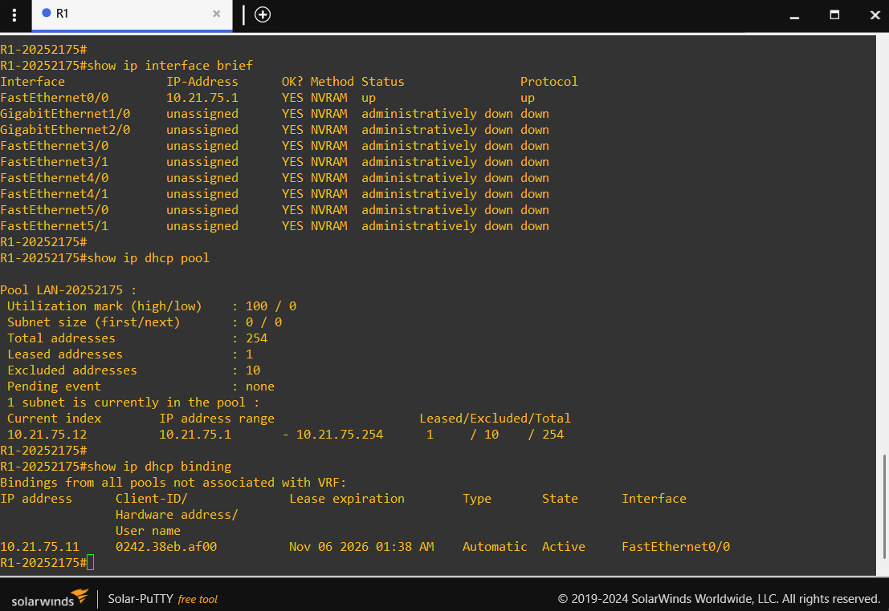
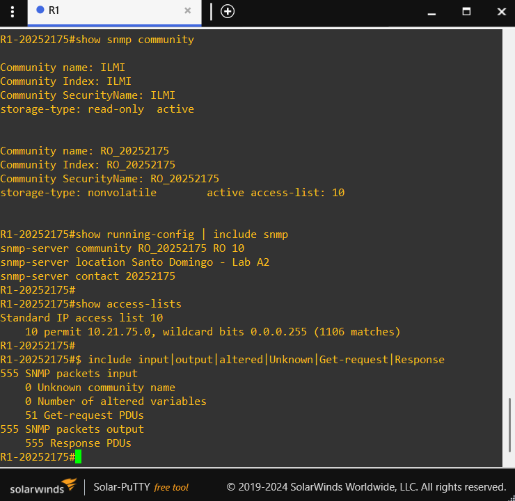

# 02 — Configuración de R1 (Cisco 7200)

R1 cumple tres funciones: gateway de la LAN `10.21.75.0/24`, servidor DHCP y agente SNMP de solo lectura.

Archivos relacionados: [`scripts/r1-config.txt`](../scripts/r1-config.txt) (configuración aplicada) y [`configs/R1/running-config.txt`](../configs/R1/running-config.txt) (running-config resultante).

## 1. Identidad y reloj

```
hostname R1-20252175
no ip domain lookup
service timestamps debug datetime msec localtime
service timestamps log datetime msec localtime
clock timezone AST -4
```

| Comando                         | Función                                                              |
|---------------------------------|----------------------------------------------------------------------|
| `hostname R1-20252175`          | Nombre del equipo con la matrícula                                   |
| `no ip domain lookup`           | Evita que un comando mal escrito intente resolverse como nombre de host |
| `service timestamps ... localtime` | Registros con fecha y hora local                                  |
| `clock timezone AST -4`         | Zona horaria de República Dominicana (UTC-4)                         |

## 2. Direccionamiento IP

```
interface FastEthernet0/0
 description LAN 10.21.75.0/24 hacia SW1
 ip address 10.21.75.1 255.255.255.0
 no shutdown
```

La interfaz `FastEthernet0/0` es la conectada a `Gi0/0` de SW1. Es el gateway de la red y la dirección que reciben los clientes como *default router*. Las demás interfaces del 7200 permanecen en `shutdown`.

[](../images/02-r1-ip-dhcp.png)

## 3. Servidor DHCP

```
ip dhcp excluded-address 10.21.75.1 10.21.75.10
ip dhcp pool LAN-20252175
 network 10.21.75.0 255.255.255.0
 default-router 10.21.75.1
 dns-server 8.8.8.8
 domain-name lab.local
 lease 0 8
```

| Comando                                         | Función                                                     |
|-------------------------------------------------|-------------------------------------------------------------|
| `ip dhcp excluded-address 10.21.75.1 10.21.75.10` | Reserva `.1` a `.10` para infraestructura                  |
| `ip dhcp pool LAN-20252175`                     | Crea el pool                                                |
| `network 10.21.75.0 255.255.255.0`              | Red y máscara que se entregan                               |
| `default-router 10.21.75.1`                     | Gateway que reciben los clientes                            |
| `dns-server 8.8.8.8`                            | Servidor DNS entregado                                      |
| `domain-name lab.local`                         | Dominio entregado                                           |
| `lease 0 8`                                     | Duración de la concesión: 0 días, 8 horas                   |

Las direcciones que se entregan van de `10.21.75.11` a `10.21.75.254`.

## 4. SNMP de solo lectura

```
access-list 10 remark SNMP-RO solo desde la LAN
access-list 10 permit 10.21.75.0 0.0.0.255
snmp-server community RO_20252175 RO 10
snmp-server location Santo Domingo - Lab A2
snmp-server contact 20252175
```

| Comando                                           | Función                                                           |
|---------------------------------------------------|-------------------------------------------------------------------|
| `access-list 10 permit 10.21.75.0 0.0.0.255`      | Define qué orígenes pueden consultar por SNMP                     |
| `snmp-server community RO_20252175 RO 10`         | Comunidad `RO_20252175`, permiso **RO**, filtrada por la ACL 10   |
| `snmp-server location` / `contact`                | Datos informativos visibles en el ítem *System location/contact*  |

La palabra clave `RO` impide cualquier operación de escritura. La ACL 10 hace que solo respondan las consultas originadas en la LAN del laboratorio.

[](../images/05-r1-snmp.png)

## 5. Consola

```
line con 0
 logging synchronous
 exec-timeout 0 0
```

`logging synchronous` evita que los mensajes del sistema interrumpan lo que se está escribiendo, y `exec-timeout 0 0` evita que la consola se cierre por inactividad durante las pruebas.

## 6. Guardado

```
write memory
```

## 7. Resultados de verificación

### Interfaz

```
R1-20252175#show ip interface brief
Interface              IP-Address      OK? Method Status                Protocol
FastEthernet0/0        10.21.75.1      YES manual up                    up
GigabitEthernet1/0     unassigned      YES unset  administratively down down
GigabitEthernet2/0     unassigned      YES unset  administratively down down
```

### Pool y concesión DHCP

```
R1-20252175#show ip dhcp pool

Pool LAN-20252175 :
 Utilization mark (high/low)    : 100 / 0
 Subnet size (first/next)       : 0 / 0
 Total addresses                : 254
 Leased addresses               : 1
 Excluded addresses             : 10
 Pending event                  : none
 1 subnet is currently in the pool :
 Current index        IP address range                    Leased/Excluded/Total
 10.21.75.12          10.21.75.1       - 10.21.75.254      1     / 10    / 254

R1-20252175#show ip dhcp binding
Bindings from all pools not associated with VRF:
IP address      Client-ID/              Lease expiration        Type       State      Interface
                Hardware address/
                User name
10.21.75.11     0242.c89e.c800          Nov 04 2026 05:06 AM    Automatic  Active     FastEthernet0/0
```

La concesión `10.21.75.11` corresponde a la dirección MAC `0242.c89e.c800` del contenedor Zabbix.

### Mensajes DHCP

```
Message              Sent
BOOTREPLY            0
DHCPOFFER            1
DHCPACK              1
DHCPNAK              0

Message              Received
DHCPDISCOVER         1
DHCPREQUEST          1
```

Se completó el ciclo DISCOVER, OFFER, REQUEST y ACK. `show ip dhcp conflict` no reportó direcciones en conflicto.

### Conectividad

```
R1-20252175#ping 10.21.75.2
!!!!!
Success rate is 100 percent (5/5), round-trip min/avg/max = 12/15/16 ms

R1-20252175#ping 10.21.75.11
!!!!!
Success rate is 100 percent (5/5), round-trip min/avg/max = 12/15/16 ms
```

### SNMP

```
R1-20252175#show snmp community

Community name: ILMI
Community Index: ILMI
Community SecurityName: ILMI
storage-type: read-only  active


Community name: RO_20252175
Community Index: RO_20252175
Community SecurityName: RO_20252175
storage-type: nonvolatile        active access-list: 10

R1-20252175#show running-config | include snmp
snmp-server community RO_20252175 RO 10
snmp-server location Santo Domingo - Lab A2
snmp-server contact 20252175

R1-20252175#show access-lists
Standard IP access list 10
    10 permit 10.21.75.0, wildcard bits 0.0.0.255 (986 matches)
```

```
R1-20252175#show snmp
532 SNMP packets input
    0 Bad SNMP version errors
    0 Unknown community name
    0 Illegal operation for community name supplied
    0 Encoding errors
    54 Number of requested variables
    0 Number of altered variables
    54 Get-request PDUs
    0 Get-next PDUs
    0 Set-request PDUs
532 SNMP packets output
    0 Too big errors (Maximum packet size 1500)
    0 No such name errors
    0 Bad values errors
    0 General errors
    532 Response PDUs
    0 Trap PDUs
```

Los contadores de la ACL y de paquetes SNMP aumentan mientras Zabbix consulta. Los contadores `Unknown community name`, `Illegal operation` y `Number of altered variables` permanecen en cero.

La comunidad `ILMI` es de solo lectura y aparece de forma predeterminada en este IOS. No fue creada en este laboratorio.
