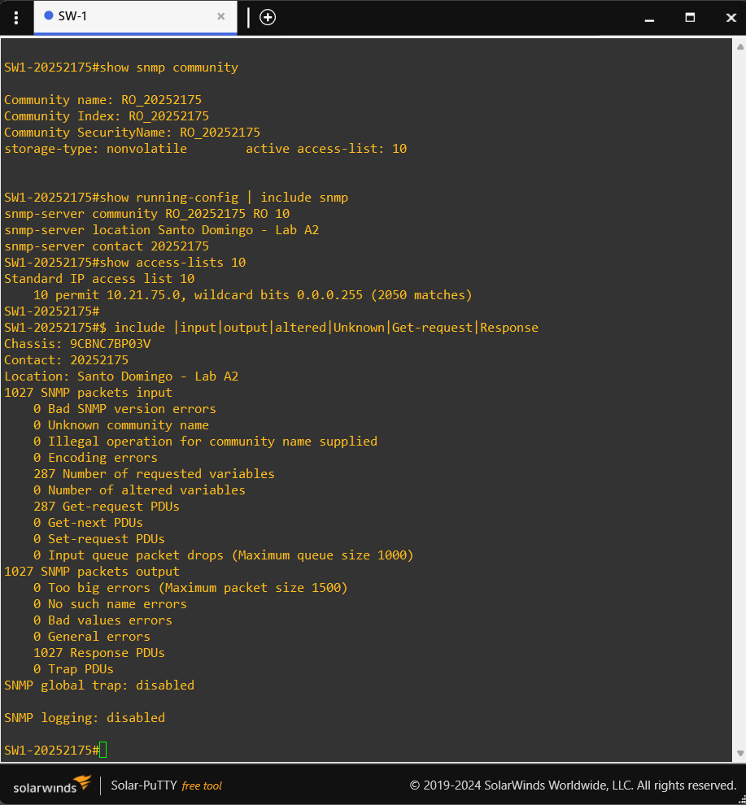
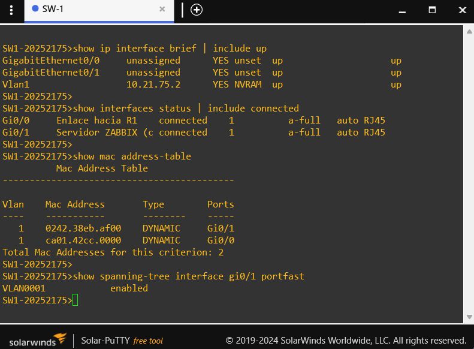

# 03 — Configuración de SW1 (IOSvL2)

SW1 conmuta el tráfico entre R1 y el servidor Zabbix dentro de la VLAN 1, tiene una dirección de gestión propia y responde consultas SNMP de solo lectura.

Archivos relacionados: [`scripts/sw1-config.txt`](../scripts/sw1-config.txt) (configuración aplicada) y [`configs/SW1/running-config.txt`](../configs/SW1/running-config.txt) (running-config resultante).

## 1. Identidad y reloj

```
hostname SW1-20252175
no ip domain-lookup
service timestamps debug datetime msec localtime
service timestamps log datetime msec localtime
clock timezone AST -4
no ip routing
```

`no ip routing` mantiene el equipo como switch de capa 2: no enruta entre redes y depende del gateway `10.21.75.1` de R1.

## 2. Direccionamiento IP de gestión

```
interface Vlan1
 description Gestion SW1
 ip address 10.21.75.2 255.255.255.0
 no shutdown
ip default-gateway 10.21.75.1
```

La interfaz virtual `Vlan1` es la dirección con la que Zabbix consulta al switch por SNMP. El `ip default-gateway` permite que SW1 responda a orígenes fuera de su subred.

## 3. Puertos

```
interface GigabitEthernet0/0
 description Enlace hacia R1
 switchport mode access
 no shutdown
interface GigabitEthernet0/1
 description Servidor ZABBIX (cliente DHCP)
 switchport mode access
 spanning-tree portfast
 no shutdown
```

| Puerto    | Conectado a  | Modo    | Particularidad                                                  |
|-----------|--------------|---------|-----------------------------------------------------------------|
| `Gi0/0`   | R1 `Fa0/0`   | access  | VLAN 1                                                          |
| `Gi0/1`   | Zabbix `eth0`| access  | `portfast`: reenvía de inmediato y el DHCP no espera a STP      |

En la running-config, IOS muestra el comando como `spanning-tree portfast edge`.

## 4. SNMP de solo lectura

```
access-list 10 remark SNMP-RO solo desde la LAN
access-list 10 permit 10.21.75.0 0.0.0.255
snmp-server community RO_20252175 RO 10
snmp-server location Santo Domingo - Lab A2
snmp-server contact 20252175
```

La comunidad, el permiso `RO` y la ACL son los mismos que en R1, de modo que Zabbix usa un único valor en la macro `{$SNMP_COMMUNITY}` para ambos equipos.

[](../images/06-sw1-snmp.png)

## 5. Consola y guardado

```
line con 0
 exec-timeout 0 0
 logging synchronous
end
write memory
```

## 6. Resultados de verificación

### Interfaces

```
SW1-20252175#show ip interface brief
Interface              IP-Address      OK? Method Status                Protocol
GigabitEthernet0/0     unassigned      YES unset  up                    up
GigabitEthernet0/1     unassigned      YES unset  up                    up
Vlan1                  10.21.75.2      YES manual up                    up

SW1-20252175#show interfaces status

Port      Name               Status       Vlan       Duplex  Speed Type
Gi0/0     Enlace hacia R1    connected    1          a-full   auto RJ45
Gi0/1     Servidor ZABBIX (c connected    1          a-full   auto RJ45
```

### PortFast y tabla MAC

```
SW1-20252175#show spanning-tree interface gi0/1 portfast
VLAN0001            enabled

SW1-20252175#show mac address-table
          Mac Address Table
-------------------------------------------

Vlan    Mac Address       Type        Ports
----    -----------       --------    -----
   1    0242.c89e.c800    DYNAMIC     Gi0/1
   1    ca01.42cc.0000    DYNAMIC     Gi0/0
Total Mac Addresses for this criterion: 2
```

La MAC `0242.c89e.c800` aprendida en `Gi0/1` es la misma que figura en la concesión DHCP de R1, lo que confirma que el cliente DHCP es el contenedor Zabbix conectado a ese puerto. La MAC aprendida en `Gi0/0` corresponde a R1.

[](../images/03-sw1-ip-mac.png)

### Conectividad

```
SW1-20252175#ping 10.21.75.1
!!!!!
Success rate is 100 percent (5/5), round-trip min/avg/max = 10/12/14 ms
```

### SNMP

```
SW1-20252175#show snmp community

Community name: RO_20252175
Community Index: RO_20252175
Community SecurityName: RO_20252175
storage-type: nonvolatile        active access-list: 10

SW1-20252175#show access-lists
Standard IP access list 10
    10 permit 10.21.75.0, wildcard bits 0.0.0.255 (880 matches)
```

```
SW1-20252175#show snmp
440 SNMP packets input
    0 Bad SNMP version errors
    0 Unknown community name
    0 Illegal operation for community name supplied
    0 Encoding errors
    128 Number of requested variables
    0 Number of altered variables
    128 Get-request PDUs
    0 Get-next PDUs
    0 Set-request PDUs
440 SNMP packets output
    0 Too big errors (Maximum packet size 1500)
    0 No such name errors
    0 Bad values errors
    0 General errors
    440 Response PDUs
    0 Trap PDUs
```

`show access-lists` en el IOSvL2 muestra además ACL predefinidas de la imagen (`CISCO-CWA-URL-REDIRECT-ACL` y `preauth_*`) que no forman parte de la configuración del laboratorio.
