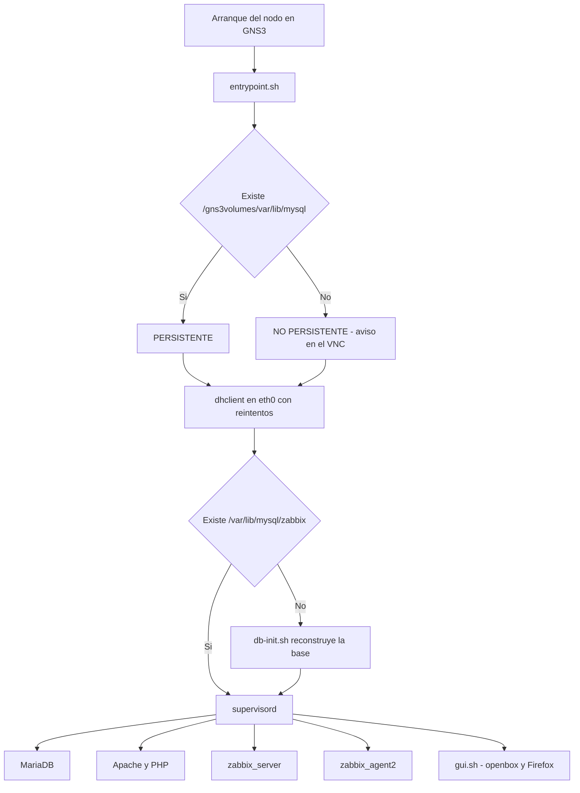

# 04 — Contenedor Zabbix para GNS3

La imagen `zabbix:7.0` empaqueta en un solo contenedor todo lo necesario para monitorear por SNMP desde GNS3 y operar la interfaz web desde la consola VNC, sin instalar un entorno de escritorio en la GNS3 VM.

Código fuente: [`docker/Zabbix`](../docker/Zabbix).

## 1. Requisitos de diseño

| Requisito                                              | Solución                                                              |
|--------------------------------------------------------|-----------------------------------------------------------------------|
| Funcionar como nodo de GNS3                            | Imagen Docker local usada desde una plantilla de GNS3                 |
| Abrir la web de Zabbix desde la consola del nodo       | Consola tipo `vnc` con Firefox ESR lanzado automáticamente           |
| Ser cliente DHCP                                       | `dhclient` en `eth0`, con reintentos                                  |
| Poder monitorear R1 y SW1 por SNMP                     | Zabbix server 7.0 LTS y herramientas `snmp`                           |
| No perder la configuración al cerrar el proyecto       | Directorio persistente `/var/lib/mysql`                               |
| Arranque rápido                                        | Base de datos creada durante `docker build`                           |

## 2. Contenido del directorio `docker/Zabbix`

| Archivo             | Función                                                                    |
|---------------------|----------------------------------------------------------------------------|
| `Dockerfile`        | Construye la imagen                                                        |
| `entrypoint.sh`     | Prepara directorios, detecta persistencia, lanza DHCP y `supervisord`      |
| `supervisord.conf`  | Define los procesos del contenedor                                         |
| `db-init.sh`        | Crea la base de datos `zabbix` e importa el esquema                        |
| `gui.sh`            | Inicia openbox y Firefox sobre el display VNC                              |
| `zabbix.conf.php`   | Configuración del frontend (omite el asistente web)                        |
| `99-zabbix.cnf`     | Parámetros de MariaDB                                                      |
| `user.js`           | Preferencias del perfil de Firefox                                         |
| `zbx-status.sh`     | Diagnóstico del contenedor                                                 |
| `zbx-add-hosts.sh`  | Alta de R1 y SW1 por la API de Zabbix                                      |
| `zbx-export.sh`     | Exportación de los hosts a YAML por la API                                 |

## 3. Cómo se construye la imagen

El `Dockerfile` realiza, en orden:

1. Parte de `debian:12` y agrega el repositorio oficial de Zabbix 7.0 (`zabbix-release`).
2. Instala Zabbix server, frontend, agent 2, MariaDB, Apache con PHP, supervisor, Firefox ESR, openbox, xterm, `isc-dhcp-client` y las herramientas de red (`snmp`, `iproute2`, `iputils-ping`, `traceroute`, `tcpdump`, `zabbix-get`, `jq`, `curl`).
3. Copia los archivos de configuración y los scripts.
4. Ajusta la contraseña de la base de datos en `zabbix_server.conf`, la zona horaria de PHP (`America/Santo_Domingo`) y la ventana de openbox para que se abra maximizada.
5. Ejecuta `db-init.sh`: arranca MariaDB, crea la base `zabbix` (`utf8mb4`, `utf8mb4_bin`), crea el usuario local y carga `server.sql.gz`.
6. Ejecuta verificaciones: sintaxis de Apache, módulo PHP cargado, versiones de `zabbix_server`, `zabbix_agent2` y Firefox, y existencia de la base de datos. Si alguna falla, el build se detiene.

## 4. Cómo arranca el contenedor



`supervisord` mantiene los procesos activos y los reinicia si fallan. `zabbix_server` espera a que MariaDB responda antes de iniciar. `gui.sh` espera a que exista el socket del display VNC y a que Apache responda, y entonces abre Firefox en `http://127.0.0.1/zabbix/`.

## 5. Construcción y prueba

Se realizan en la GNS3 VM (o en cualquier host Docker):

```
bash scripts/build-image.sh
bash scripts/test-container.sh
```

`test-container.sh` inicia un contenedor de prueba, espera 60 segundos, ejecuta `zbx-status.sh`, genera una captura con Firefox en modo *headless* y elimina el contenedor. Una prueba correcta muestra `[OK]` en `mariadbd`, `apache2`, `zabbix_server` y `zabbix_agent2`, la respuesta HTTP 200 o 302 en `/zabbix/` y una captura del inicio de sesión de Zabbix.

## 6. Plantilla en GNS3

*Edit → Preferences → Docker containers → New → Existing image*, imagen `zabbix:7.0`:

| Campo                             | Valor              |
|-----------------------------------|--------------------|
| Name                              | `Zabbix`           |
| Adapters                          | 1                  |
| Console type                      | `vnc`              |
| Console resolution                | `1280x800`         |
| Additional persistent directories | `/var/lib/mysql`   |

Los cambios en la plantilla afectan solo a los nodos nuevos. Los pasos para la persistencia están en [`07-persistencia.md`](07-persistencia.md).

## 7. Acceso

| Servicio          | Dirección                                   | Credenciales iniciales |
|-------------------|---------------------------------------------|------------------------|
| Frontend Zabbix   | `http://127.0.0.1/zabbix/` (dentro del VNC) | `Admin` / `zabbix`     |
| Base de datos     | Socket local, usuario `zabbix`              | Solo accesible desde el propio contenedor |

La clave de `Admin` se cambia en el primer acceso (*Users → Users → Admin → Change password*).

## 8. Herramientas de la consola auxiliar

| Comando            | Función                                                       |
|--------------------|---------------------------------------------------------------|
| `zbx-status.sh`    | Estado de persistencia, IP, procesos, web y base de datos     |
| `zbx-add-hosts.sh` | Crea R1 y SW1 por API con SNMPv2 y las plantillas             |
| `zbx-export.sh`    | Exporta a YAML los hosts del laboratorio                      |
| `snmpget`, `snmpwalk`, `snmpset` | Pruebas SNMP desde el servidor                  |
| `ping`, `traceroute`, `tcpdump`  | Pruebas de red                                  |

## 9. Publicación en Docker Hub

```
docker login -u USUARIO_DOCKERHUB
bash scripts/publish-image.sh USUARIO_DOCKERHUB
```

El script etiqueta la imagen como `USUARIO_DOCKERHUB/zabbix:7.0` y `USUARIO_DOCKERHUB/zabbix:latest` y las sube. Para usarla en otra instalación de GNS3, se crea la plantilla con *New image* e indicando ese nombre.
