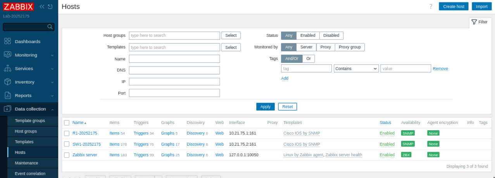
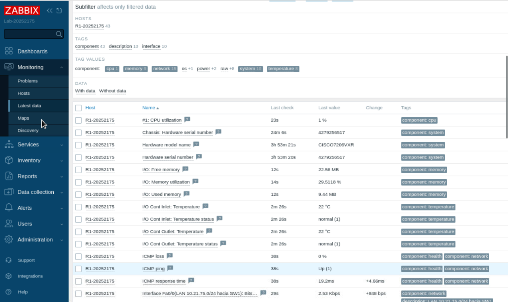
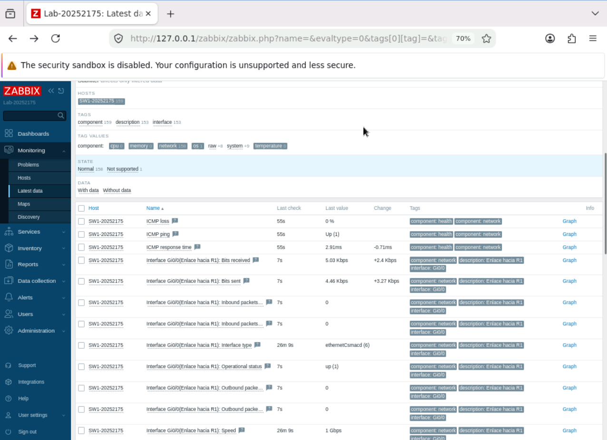

# 05 — Monitoreo SNMP en Zabbix

Este documento describe cómo se registran R1 y SW1 en Zabbix y qué datos se recolectan.

## 1. Acceso inicial

Dentro de la consola VNC del nodo Zabbix, Firefox abre `http://127.0.0.1/zabbix/`. Se ingresa con `Admin` / `zabbix` y se cambia la clave en *Users → Users → Admin → Change password*.

## 2. Macro de la comunidad SNMP

Los hosts usan la macro `{$SNMP_COMMUNITY}` en el campo de comunidad de su interfaz. El valor real se define una sola vez por host en la pestaña *Macros*. De este modo la comunidad no se escribe en la interfaz y se puede cambiar sin tocar la configuración de las plantillas.

| Macro                  | Valor          |
|------------------------|----------------|
| `{$SNMP_COMMUNITY}`    | `RO_20252175`  |

## 3. Alta de los hosts

*Data collection → Hosts → Create host*:

| Campo             | R1                                  | SW1                                 |
|-------------------|-------------------------------------|-------------------------------------|
| Host name         | `R1-20252175`                       | `SW1-20252175`                      |
| Templates         | Cisco IOS by SNMP                   | Cisco IOS by SNMP                   |
| Host groups       | Network devices                     | Network devices                     |
| Interface         | SNMP                                | SNMP                                |
| IP address        | `10.21.75.1`                        | `10.21.75.2`                        |
| Port              | `161`                               | `161`                               |
| SNMP version      | SNMPv2                              | SNMPv2                              |
| SNMP community    | `{$SNMP_COMMUNITY}`                 | `{$SNMP_COMMUNITY}`                 |
| Macros            | `{$SNMP_COMMUNITY}` = `RO_20252175` | `{$SNMP_COMMUNITY}` = `RO_20252175` |

La plantilla *ICMP Ping* puede añadirse como complemento para medir disponibilidad y tiempo de respuesta por ICMP.

### Alta por script

El mismo resultado se obtiene desde la consola auxiliar del contenedor con la API de Zabbix:

```
ZPASS=CLAVE_DE_ADMIN zbx-add-hosts.sh
```

El script inicia sesión, crea el grupo `Network devices` si no existe, busca las plantillas *Cisco IOS by SNMP* e *ICMP Ping* y crea los dos hosts con la interfaz SNMPv2 y la macro.

## 4. Qué recolecta la plantilla

La plantilla *Cisco IOS by SNMP* consulta, entre otros:

| Grupo                | Ejemplos                                                       |
|----------------------|----------------------------------------------------------------|
| Sistema              | Descripción del sistema, nombre, ubicación, contacto, uptime   |
| Disponibilidad       | Disponibilidad del agente SNMP                                 |
| Interfaces           | Estado operativo, bits recibidos y enviados, errores           |
| Recursos             | CPU y memoria (según lo que soporte el equipo)                 |

En equipos virtuales, algunos ítems de CPU, memoria o temperatura pueden quedar como *Not supported* porque la imagen no expone esos datos. Esto no afecta la recolección de los datos de sistema ni de las interfaces.

## 5. Dónde ver los datos

| Qué se quiere ver                       | Dónde                                                              |
|-----------------------------------------|--------------------------------------------------------------------|
| Disponibilidad SNMP de cada host        | *Data collection → Hosts* → columna Availability                   |
| Valores recolectados                    | *Monitoring → Latest data* → filtrar por host                      |
| Evolución de un valor                   | *Latest data* → enlace **Graph** del ítem                          |
| Alertas                                 | *Monitoring → Problems*                                            |

[](../images/07-zabbix-hosts-snmp.png)

[](../images/08-zabbix-latest-data-r1.png)

[](../images/09-zabbix-latest-data-sw1.png)

## 6. Respaldo de los hosts

```
ZPASS=CLAVE_DE_ADMIN zbx-export.sh
```

Genera `/root/zabbix-hosts-export.yaml` con los hosts cuyo nombre contiene `20252175`. También puede hacerse desde la interfaz con *Data collection → Hosts → Export → YAML*.
