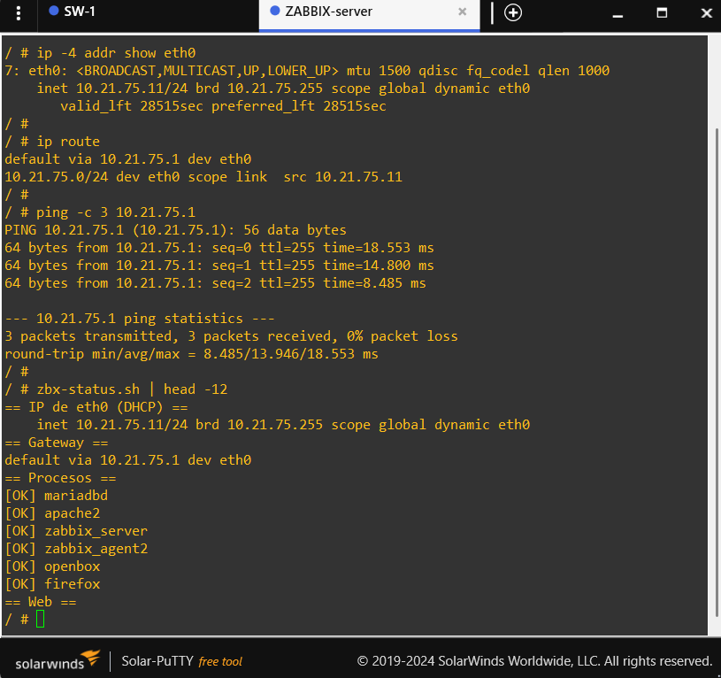
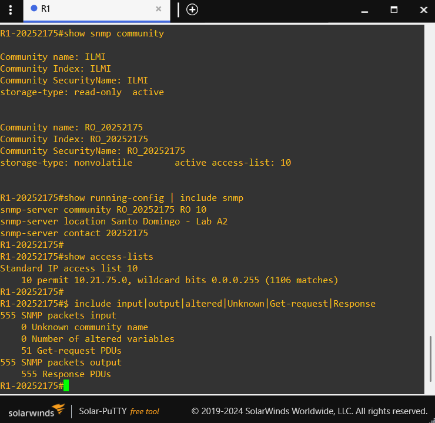
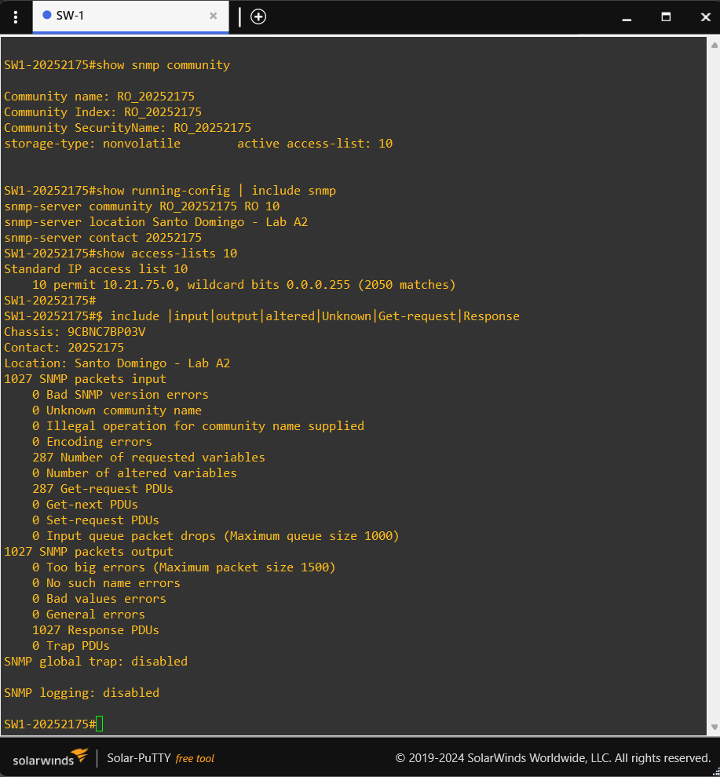
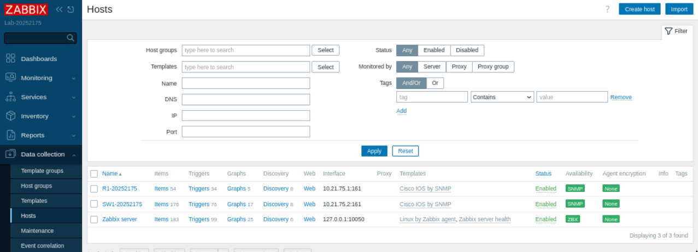
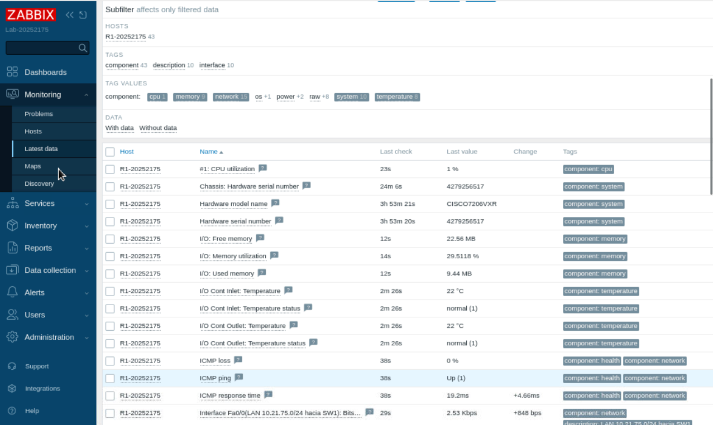
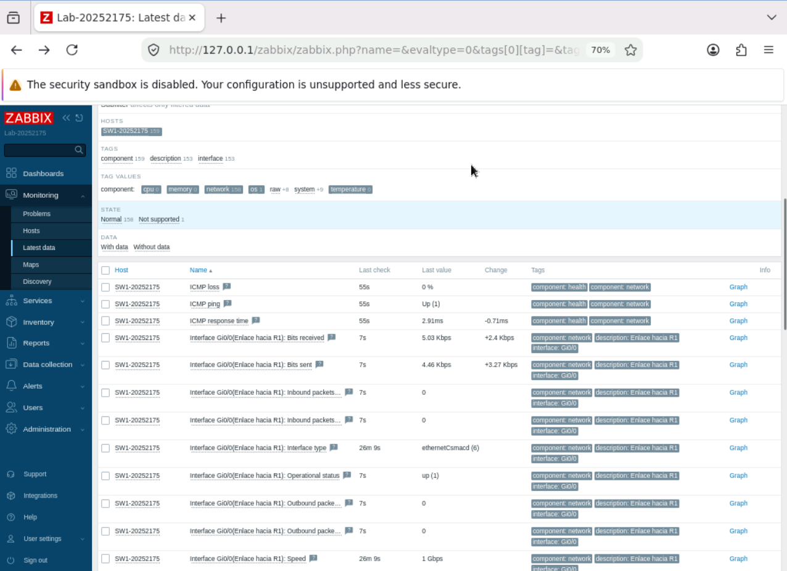
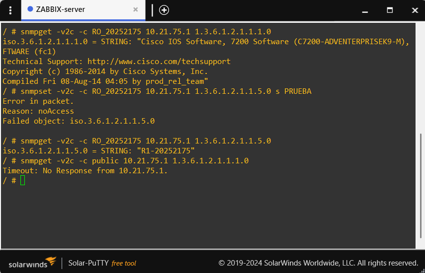
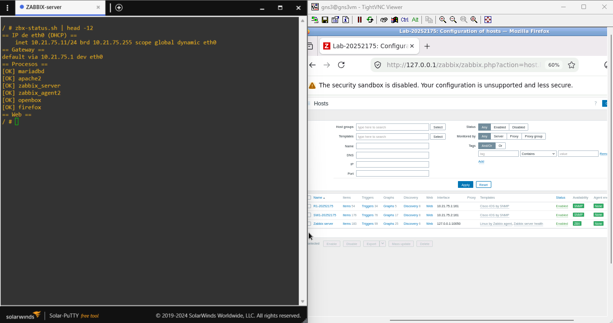

# 06 — Plan de verificación y resultados

La verificación se hizo por capas: cada fase depende de que la anterior sea correcta. Los comandos están reunidos en [`scripts/verification-commands.md`](../scripts/verification-commands.md).

## Fase 1 — Capa 3 y conectividad

| # | Prueba                           | Dónde | Comando                      | Resultado esperado                              |
|---|----------------------------------|-------|------------------------------|-------------------------------------------------|
| 1 | IP y estado de la interfaz de R1 | R1    | `show ip interface brief`    | `Fa0/0` con `10.21.75.1` en `up/up`             |
| 2 | IP de gestión de SW1             | SW1   | `show ip interface brief`    | `Vlan1` con `10.21.75.2` en `up/up`             |
| 3 | Puertos de SW1                   | SW1   | `show interfaces status`     | `Gi0/0` y `Gi0/1` en `connected`, VLAN 1        |
| 4 | R1 hacia SW1                     | R1    | `ping 10.21.75.2`            | 100 % de éxito                                  |
| 5 | SW1 hacia R1                     | SW1   | `ping 10.21.75.1`            | 100 % de éxito                                  |

Resultados obtenidos: [`02-router-r1.md`](02-router-r1.md) y [`03-switch-sw1.md`](03-switch-sw1.md).

## Fase 2 — DHCP

| # | Prueba                              | Dónde  | Comando                                   | Resultado esperado                                          |
|---|-------------------------------------|--------|-------------------------------------------|-------------------------------------------------------------|
| 6 | Pool configurado                    | R1     | `show ip dhcp pool`                       | Red `10.21.75.0/24`, 10 direcciones excluidas               |
| 7 | Concesión a Zabbix                  | R1     | `show ip dhcp binding`                    | IP entre `.11` y `.254` con la MAC del contenedor           |
| 8 | Ciclo DHCP completo                 | R1     | `show ip dhcp server statistics`          | DISCOVER, OFFER, REQUEST y ACK con contadores mayores a 0   |
| 9 | Sin conflictos                      | R1     | `show ip dhcp conflict`                   | Sin entradas                                                |
| 10| La MAC del cliente está en `Gi0/1`  | SW1    | `show mac address-table`                  | MAC de Zabbix en `Gi0/1`, igual a la del binding            |
| 11| Zabbix tiene IP y gateway           | Zabbix | `ip -4 addr show eth0` y `ip route`       | IP del pool y gateway `10.21.75.1`                          |

Resultado obtenido: la concesión fue `10.21.75.11` para la MAC `0242.c89e.c800`, con los mensajes DISCOVER, OFFER, REQUEST y ACK completos y sin conflictos.

## Fase 3 — SNMP en los equipos

| # | Prueba                          | Dónde  | Comando                                  | Resultado esperado                                                  |
|---|---------------------------------|--------|------------------------------------------|---------------------------------------------------------------------|
| 12| Comunidad de solo lectura       | R1, SW1| `show snmp community`                    | `RO_20252175` activa con `access-list: 10`                          |
| 13| Tipo de acceso                  | R1, SW1| `show running-config \| include snmp`    | `snmp-server community RO_20252175 RO 10`                           |
| 14| ACL de origen                   | R1, SW1| `show access-lists`                      | `permit 10.21.75.0 0.0.0.255` con contadores que aumentan           |
| 15| Zabbix está consultando         | R1, SW1| `show snmp`                              | `Get-request PDUs` y `Response PDUs` aumentan; errores en cero      |

Resultado obtenido: ambos equipos respondieron todas las consultas recibidas (532 de 532 en R1 y 440 de 440 en SW1), con `Unknown community name`, `Illegal operation` y `Number of altered variables` en cero.

## Fase 4 — Datos en Zabbix

| # | Prueba                       | Dónde                              | Resultado esperado                                         |
|---|------------------------------|------------------------------------|------------------------------------------------------------|
| 16| Disponibilidad SNMP          | *Data collection → Hosts*          | Indicador **SNMP** en verde para R1 y SW1                  |
| 17| Datos de R1                  | *Monitoring → Latest data* (R1)    | Descripción del sistema, nombre, uptime e interfaces con valor |
| 18| Datos de SW1                 | *Monitoring → Latest data* (SW1)   | Descripción del sistema, nombre, uptime e interfaces con valor |
| 19| Recolección continua         | *Latest data*                      | La columna *Last check* cambia y el uptime aumenta         |
| 20| Sin problemas de conectividad| *Monitoring → Problems*            | Sin *No SNMP data collection* ni *Unavailable by ICMP ping*|

## Fase 5 — SNMP es de solo lectura

Se ejecutan desde la consola auxiliar del contenedor Zabbix:

| # | Prueba                      | Comando                                                                  | Resultado esperado                                      |
|---|-----------------------------|--------------------------------------------------------------------------|---------------------------------------------------------|
| 21| Lectura con la comunidad    | `snmpget -v2c -c RO_20252175 10.21.75.1 1.3.6.1.2.1.1.1.0`               | Devuelve la descripción del sistema                     |
| 22| Lectura en el switch        | `snmpget -v2c -c RO_20252175 10.21.75.2 1.3.6.1.2.1.1.1.0`               | Devuelve la descripción del sistema                     |
| 23| Escritura                   | `snmpset -v2c -c RO_20252175 10.21.75.1 1.3.6.1.2.1.1.5.0 s PRUEBA`      | Error de acceso; el nombre del equipo no cambia         |
| 24| Comunidad por defecto       | `snmpget -v2c -c public 10.21.75.1 1.3.6.1.2.1.1.1.0`                    | Sin respuesta (timeout)                                 |
| 25| Contador de escritura       | `show snmp` en R1                                                         | `Number of altered variables` permanece en 0            |

## Fase 6 — Persistencia

| # | Prueba                                  | Resultado esperado                                                         |
|---|-----------------------------------------|----------------------------------------------------------------------------|
| 26| Estado de persistencia                  | `zbx-status.sh` indica `PERSISTENTE`                                       |
| 27| Montaje                                 | `docker inspect` muestra el destino `/gns3volumes/var/lib/mysql`           |
| 28| Reinicio completo del proyecto          | Zabbix conserva la clave de Admin y los hosts; el SNMP vuelve a estar disponible |

